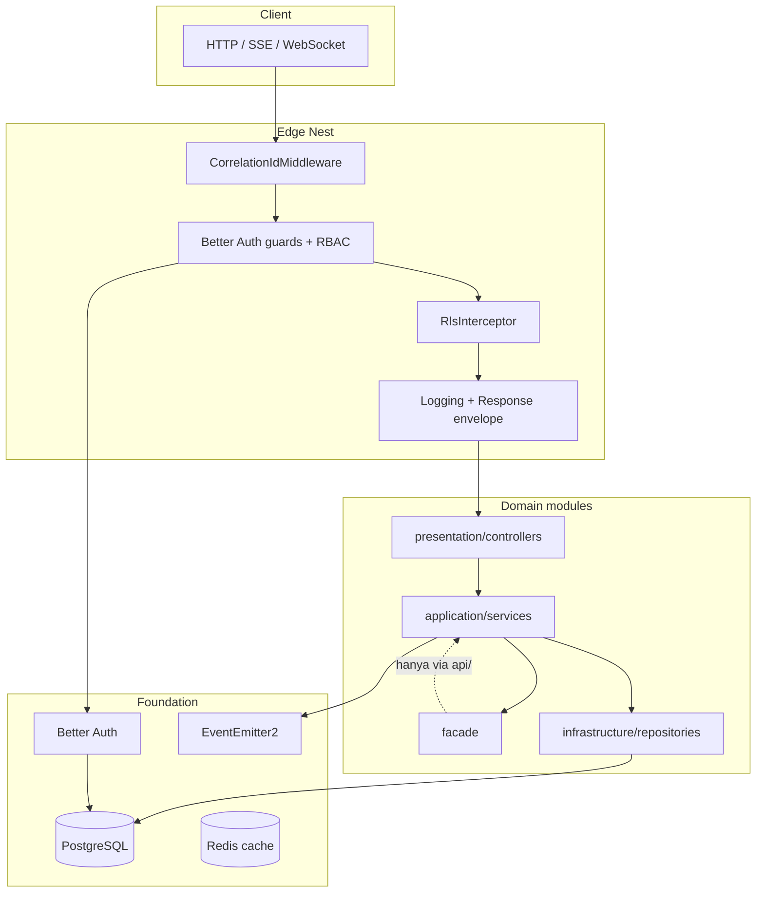
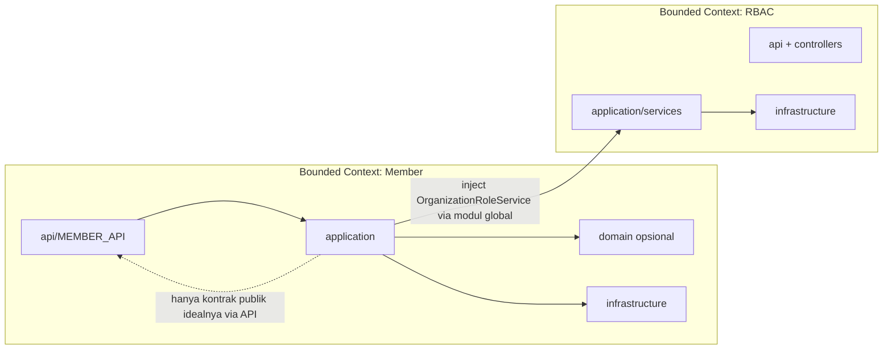
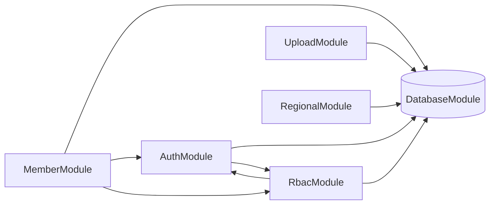

# Arsitektur Backend — NestJS 11 Boilerplate

Dokumen ini menjelaskan **bagaimana codebase disusun**, **alur request**, dan **aturan dependensi** antar bagian. Ini boilerplate reusable multi-organisasi; modul sample opsional ada di [`samples/README.md`](samples/README.md).

Untuk aturan modul dan anti-pattern: [`modular-monolith.md`](modular-monolith.md), [`anti-patterns-reference.md`](anti-patterns-reference.md).

---

## 1. Pola arsitektur

**Modular monolith** dengan **filosofi DDD (Domain-Driven Design) yang pragmatis** — satu proses deployable, tiap folder `src/modules/<nama>/` diperlakukan sebagai **bounded context**, dengan lapisan aplikasi/domain/infrastruktur dan komunikasi antar konteks lewat **public API** (facade/token) atau **domain events**. Detail filosofi DDD: [§2](#2-filosofi-ddd-domain-driven-design).

Batas modul tegas: **bukan** import silang ke `application/` / `infrastructure/` modul lain.

| Konsep        | Implementasi                                                            |
| ------------- | ----------------------------------------------------------------------- |
| Satu binary   | `main.ts` → `AppModule`                                                 |
| Batas modul   | `src/modules/<nama>/` dengan folder `api/` sebagai gerbang lintas modul |
| Shared kernel | `src/shared/` — event bus, RLS, realtime, push (bukan domain bisnis)    |
| Cross-cutting | `src/common/`, `src/config/`, `src/logger/`, `src/infrastructure/`      |
| Persistence   | `src/database/schema/` (Drizzle) + repository per modul                 |



---

## 2. Filosofi DDD (Domain-Driven Design)

### Apakah codebase ini “pakai DDD”?

**Ya — secara strategis dan selektif secara taktis**, bukan implementasi DDD “buku tebal” di setiap baris kode.

| Aspek DDD                           | Di boilerplate ini                                                                                 |
| ----------------------------------- | -------------------------------------------------------------------------------------------------- |
| **Strategic:** Bounded context      | Satu modul = satu konteks bisnis (`member`, `rbac`, `upload`, …)                                   |
| **Strategic:** Ubiquitous language  | Nama modul, DTO di `api/`, event di `DomainEventMap` memakai istilah domain, bukan istilah DB/HTTP |
| **Strategic:** Konteks map implisit | Hubungan antar modul hanya lewat `api/` + events (konteks tidak “bocor”)                           |
| **Tactical:** Application service   | `application/*.service.ts` — orkestrasi use case, transaksi, panggilan repo/facade lain            |
| **Tactical:** Domain model          | Folder `domain/` **opsional** — entity/value object/ domain error saat logic bisnis padat          |
| **Tactical:** Repository            | `infrastructure/*repository.ts` — abstraksi persistence                                            |
| **Tactical:** Domain events         | `EventEmitter2` + perluasan `DomainEventMap`                                                       |
| **Anti-corruption / public API**    | `facade/` + token `*_API` — modul luar hanya lihat kontrak `api/`                                  |

Yang **sengaja tidak diwajibkan** di semua modul (agar boilerplate tetap ringan):

- Aggregate root & invariant kompleks di setiap entity
- Value object untuk setiap field
- Event sourcing / CQRS penuh
- Model domain “murni” tanpa service (banyak modul referensi memakai **application service + repository**, pola yang umum di Nest)

Modul dengan aturan bisnis berat **boleh** mengisi `domain/` dan `DomainError`; modul CRUD tipis (mis. `regional`) cukup application + infrastructure. Rujuk [`testing.md`](testing.md) (coverage `domain/`).

**Catatan istilah:** `src/shared/` di repo ini adalah **infrastruktur horizontal** (event bus, RLS, SSE), bukan “Shared Kernel” DDD dalam arti dua bounded context berbagi **model domain** bisnis.

### Kenapa memilih DDD (bersama modular monolith)?

1. **Produk multi-organisasi** — tenant (`organizationId`) dan RBAC adalah concern horizontal; domain **member**, **role**, **upload** harus tetap terpisah agar aturan bisnis tidak tercampur dengan auth/infra.
2. **Tim dan fitur bertumbuh** — batas modul = batas tanggung jawab PR/review; mengurangi “god service” yang mengimpor repository modul lain.
3. **Evolusi deploy** — monolith tetap satu binary, tetapi bounded context yang jelas memudahkan **ekstraksi ke service terpisah** nanti tanpa rewrite total.
4. **Konsistensi dengan stack** — Better Auth + organization plugin sudah memodelkan “organisasi” sebagai konteks; DDD menyelaraskan kode aplikasi dengan batas tersebut.
5. **Boilerplate untuk banyak produk** — fork produk hanya menambah modul baru mengikuti `_template`, tanpa merusak modul core.

### Tujuan DDD dalam proyek ini

| Tujuan                              | Manifestasi di codebase                                                                               |
| ----------------------------------- | ----------------------------------------------------------------------------------------------------- |
| **Kode mencerminkan bahasa bisnis** | Route & modul bernama menurut kapabilitas (`member`, `rbac`), bukan menurut tabel generik             |
| **Isolasi perubahan**               | Ubah persistence `member` tanpa menyentuh `rbac`, selama kontrak `MEMBER_API` stabil                  |
| **Use case eksplisit**              | Controller tipis; keputusan bisnis di `application/` (invite, ubah role, CRUD permission)             |
| **Integrasi tanpa coupling**        | Modul A memanggil B lewat facade; reaksi async lewat event (`order.created`, `rbac.cache.invalidate`) |
| **Uji yang bermakna**               | Test service/facade dengan boundary jelas; mock `*_API` bukan repository internal modul lain          |

### Kelebihan (yang dirasakan di daily development)

- **Maintainability** — tahu “where to put code” dari struktur folder; ESLint `no-cross-module-import` memperkuat aturan DDD secara otomatis.
- **Onboarding** — developer baru belajar satu pola (`_template` / `regional`) lalu mengulang di modul baru.
- **Keamanan arsitektur** — sulit secara tidak sengaja mengexpose entity DB atau query modul lain (harus lewat `api/`).
- **Skalabilitas tim** — ownership per modul/deployment unit logis jelas sebelum microservices.
- **Fleksibilitas domain** — area kompleks bisa ditambah `domain/` + rich model; area sederhana tetap lean.

### Kapan **tidak** perlu memaksakan DDD lebih dalam?

- CRUD master data dengan sedikit aturan → cukup application + repository (contoh `regional`).
- Integrasi murni (adapter WAHA, S3) → lebih dekat ke **infrastructure module** daripada bounded context bisnis penuh.
- Skrip one-off / seed → di luar pola modul domain.

Untuk aturan “boleh / tidak boleh” import: [`modular-monolith.md`](modular-monolith.md) dan [`anti-patterns-reference.md`](anti-patterns-reference.md#1-direct-cross-module-import).



_(Praktik nyata: beberapa concern seperti RBAC diekspor sebagai module global Nest; untuk modul bisnis baru, tetap utamakan token `*_API`.)_

---

## 3. Stack utama

| Lapisan           | Teknologi                                                                 | Catatan                                              |
| ----------------- | ------------------------------------------------------------------------- | ---------------------------------------------------- |
| Runtime & HTTP    | NestJS 11 + **Fastify**                                                   | Versioning URI: `/v1/...`                            |
| Validasi input    | `class-validator` + `ValidationPipe`                                      | Global di bootstrap                                  |
| Env               | **Zod** (`config/env.validation.ts`)                                      | Fail fast saat startup                               |
| Database          | PostgreSQL + **Drizzle ORM**                                              | Pool global `DatabaseModule`                         |
| Auth              | **Better Auth** + plugin `organization`                                   | Multi-org, dynamic access control                    |
| Cache sesi / auth | Redis (`GlobalCacheModule`, `BetterAuthCacheModule`)                      | Opsional per env                                     |
| Queue             | BullMQ                                                                    | Konfigurasi ada; default tidak dimuat di `AppModule` |
| Log               | Winston (`LoggerModule`)                                                  | `LoggingInterceptor` per request                     |
| i18n              | `nestjs-i18n`                                                             | Resolver: query, cookie, header, Accept-Language     |
| Observability     | `MetricsModule`                                                           | Metrik aplikasi                                      |
| API docs          | OpenAPI / Scalar (bootstrap) + Better Auth OpenAPI di `/v1/auth/api/docs` | Lihat `bootstrap/openapi.config.ts`                  |

---

## 4. Peta direktori (tingkat atas)

```text
src/
├── main.ts                 # Bootstrap Fastify, global pipes/interceptors
├── app.module.ts           # Komposisi modul core
├── bootstrap/              # CORS, helmet, rate limit, multipart, OpenAPI
├── config/                 # Factory config per domain (app, auth, email, upload, …)
├── database/               # DatabaseModule, schema Drizzle terpusat
├── common/                 # Error, DTO paginasi, cache, base repository, filter global
├── logger/                 # Winston
├── infrastructure/         # Metrik dan wiring infrastruktur non-domain
├── i18n/                   # Terjemahan (mis. auth-errors)
├── modules/                # Modul domain (auth, member, rbac, …)
└── shared/                 # Foundation layer (events, RLS, realtime, push)
```

**Schema DB** diekspor dari `src/database/schema/index.ts` agar Better Auth adapter dan modul memakai definisi tabel yang sama.

**Migrasi:** `drizzle/` (baseline + migrasi lanjutan, mis. RBAC katalog `0001_rbac_permissions.sql`).

---

## 5. Komposisi startup (`AppModule`)

Urutan import di [`src/app.module.ts`](../src/app.module.ts) mengikuti prinsip: **config & infra dulu**, lalu **shared**, lalu **domain core**.

| Kelompok      | Modul                                                                                                | Peran                                             |
| ------------- | ---------------------------------------------------------------------------------------------------- | ------------------------------------------------- |
| Infra global  | `GlobalCacheModule`, `ConfigModule`, `I18nModule`, `LoggerModule`, `DatabaseModule`, `MetricsModule` | Env, log, DB, metrik                              |
| Shared kernel | `SharedEventsModule`, `RealtimeModule`, `PushNotificationModule`                                     | Event bus, SSE, FCM adapter                       |
| Domain core   | `AuthModule`, `RbacModule`, `MemberModule`, `RegionalModule`, `UploadModule`, `HealthModule`         | Auth, izin, anggota, referensi CRUD, file, health |
| Lain          | `SchedulingModule`                                                                                   | Cron terjadwal                                    |

**Provider global aplikasi:**

- `AllExceptionsFilter` — kesalahan terstruktur + i18n
- `LoggingInterceptor` — log request/response
- `ResponseEnvelopeInterceptor` — bentuk respons API konsisten

**Middleware:** `CorrelationIdMiddleware` pada semua rute (jejak log).

**Tidak termuat default di `AppModule`:** `PaymentModule`, `NotificationModule`, WhatsApp, AI — tambahkan manual atau salin pola dari [`src/modules/_template/`](../src/modules/_template/) / [`samples/`](samples/README.md).

---

## 6. Layering dalam modul domain

Setiap modul bisnis mengikuti lapisan yang sama (contoh referensi: `member`, `regional`, `_template`):

```text
modules/<nama>/
├── api/              # DTO publik, token injeksi (MEMBER_API), index export
├── application/      # Use case, orkestrasi, tanpa HTTP
├── domain/           # Opsional: entity/value object murni
├── facade/           # Implementasi token api/ — satu pintu untuk modul lain
├── infrastructure/   # Repository, schema khusus modul, Nest Module
└── presentation/     # Controller, DTO HTTP/Swagger
```

**Alur dependensi (hanya ke bawah):**

```text
presentation → application → infrastructure
                    ↑
              facade (implementasi api/)
```

### Aturan lintas modul

1. Modul **A** hanya boleh import dari `modules/B/api/` (DTO, token, konstanta publik).
2. Modul **B** mendaftarkan `provide: B_API, useClass: BFacade` dan **mengekspor** token itu.
3. **Dilarang:** `import … from '../member/application/...'` dari modul lain (dicek ESLint `modular-monolith/no-cross-module-import`).
4. **Komunikasi longgar:** `EventEmitter2` + `DomainEventMap` di [`src/shared/events/domain-event-registry.ts`](../src/shared/events/domain-event-registry.ts).

---

## 7. Request HTTP — urutan penanganan

1. **Fastify** menerima request (body limit, proxy trust dari config).
2. **Correlation ID** ditetapkan di middleware.
3. **Better Auth** (`@thallesp/nestjs-better-auth`): sesi, organisasi aktif, guard global (kecuali route `@AllowAnonymous`).
4. **`RlsInterceptor`**: mengisi `RlsContext` (AsyncLocalStorage) dengan `organizationId` dari sesi — dipakai repository/admin yang aware tenant.
5. **RBAC**: `@RequirePermission('resource:action')` + `MemberHasPermission` (Better Auth) + metadata scope (`PermissionScopeInterceptor`).
6. **Controller** memanggil **service**, service memanggil **repository** / facade modul lain / `AuthService.api`.
7. **Response envelope** dan logging diterapkan pada keluar.

Auth routes Better Auth dipasang di path terpisah (`auth.path`, default di bawah `/v1/auth`), tidak selalu melalui controller Nest domain.

---

## 8. Autentikasi & multi-organisasi

| Komponen     | Lokasi                                               | Fungsi                                                           |
| ------------ | ---------------------------------------------------- | ---------------------------------------------------------------- |
| Factory auth | `src/modules/auth/auth.ts`                           | `betterAuth()`, plugin organization, hooks                       |
| Nest wiring  | `src/modules/auth/auth.module.ts`                    | Async factory: load permission statement dari DB                 |
| User/session | Schema Better Auth (`user`, `session`, `account`, …) | Drizzle adapter                                                  |
| Organisasi   | `organization`, `member`, `invitation`               | Creator = `owner`, limit dari config                             |
| Role per org | `organization_role`                                  | JSON `permission` + `permission_scopes` (dynamic access control) |

**Hook penting (`organizationHooks`):**

- `afterCreateOrganization` — seed role dari tabel **`rbac_role_template`** (fallback konstanta bootstrap jika kosong).
- `afterAddMember` / `afterAcceptInvitation` — invalidasi cache RBAC + bridge ke `MemberModule`.

Statement Better Auth (resource → actions) dimuat saat startup dari tabel **`rbac_permission`**. Permission **baru** di katalog memerlukan **restart** agar statement AC terbarui.

Detail operasional: [`auth.md`](auth.md).

---

## 9. RBAC (access control)

| Lapisan           | Tabel / API          | Deskripsi                                                                              |
| ----------------- | -------------------- | -------------------------------------------------------------------------------------- |
| Katalog global    | `rbac_permission`    | CRUD permission (`/rbac/permissions`) — bukan lagi hardcoded constant                  |
| Template org baru | `rbac_role_template` | Default `owner` / `admin` / `member`                                                   |
| Role per org      | `organization_role`  | CRUD role + assignment permission (`/rbac/roles`, Better Auth `createOrgRole` / dll.)  |
| Assign ke user    | `member.role`        | `PATCH /admin/members/:id/role`, undangan — nama role harus ada di `organization_role` |

Modul `RbacModule` juga menyediakan **permission scope** (`permissionScopes` JSON), **audit trail**, dan cache invalidation via event `rbac.cache.invalidate`.

Konstanta `permissions.constant.ts` hanya **bootstrap** untuk test / DB kosong.

---

## 10. Lapisan data

- **Drizzle**: `DRIZZLE` token di-inject ke repository; pola umum `BaseRepository` (`soft delete`, paginasi) di `src/common/repository/base.repository.ts`.
- **Pool**: satu `pg.Pool` shared (`getSharedPool()`) — dipakai Better Auth factory dan Drizzle.
- **Schema**: file per concern di `src/database/schema/`; modul boleh punya schema tambahan di `infrastructure/` jika hanya dipakai modul itu (contoh `pending-member-link`).
- **RLS aplikasi**: bukan selalu RLS Postgres native — konteks tenant lewat `RlsContext` untuk query yang memfilter `organizationId`.

---

## 11. Foundation layer (`src/shared/`)

Ringkasan; tutorial lengkap: [`src/shared/README.md`](../src/shared/README.md).

| Subfolder            | Fungsi                                                                  |
| -------------------- | ----------------------------------------------------------------------- |
| `events/`            | `EventEmitterModule` wildcard, `DomainEventMap` untuk type-safe payload |
| `database/`          | `RlsContext`, `RlsInterceptor`                                          |
| `realtime/`          | SSE admin / monitor                                                     |
| `push-notification/` | Adapter FCM (no-op jika tidak dikonfigurasi)                            |
| `scheduling/`        | Modul cron                                                              |

Ini **bukan** tempat logic domain (order, invoice, dll.) — hanya kemampuan horizontal.

---

## 12. Error, respons API, dan DTO

- **Domain / bisnis:** `BusinessError` (`notFound`, `forbidden`, `conflict`, …) → `AllExceptionsFilter` → DTO error + kode.
- **Envelope sukses:** `ResponseEnvelopeInterceptor` (konsisten di API Nest).
- **Paginasi:** `PaginatedResponseDto`, helper di `common/dto/`.
- **Swagger:** DTO di `presentation/dto/` dengan decorator `@ApiProperty`.

---

## 13. Upload & object storage

- Modul `upload`: upload via multipart (bootstrap), metadata di DB, file di **S3-compatible** (MinIO di `docker-compose`) lewat `S3ObjectStorageService`.
- Stream/read tetap bisa lewat route uploads (lihat modul upload).

---

## 14. Email

- `EmailModule`: pengiriman + template HTML di `modules/email/templates/`.
- Dipanggil dari hook Better Auth (reset password, verifikasi, undangan organisasi) dan modul lain yang membutuhkan notifikasi email.

---

## 15. Menambah modul baru

1. Salin struktur [`src/modules/_template/`](../src/modules/_template/).
2. Definisikan `X_API` + facade + export dari `api/index.ts`.
3. Import `XModule` di `AppModule` (atau biarkan opsional).
4. Tambah schema/migrasi Drizzle bila perlu.
5. Extend `DomainEventMap` jika mem-publish event baru.
6. Jalankan `bun test`, `bun run build`, `graphify update .` setelah perubahan besar.

Panduan singkat: [`scaffold-new-module.md`](scaffold-new-module.md).

---

## 16. Tier modul (core vs opsional)

| Tier                  | Contoh                                              | Registrasi                                                                        |
| --------------------- | --------------------------------------------------- | --------------------------------------------------------------------------------- |
| **Core**              | auth, member, rbac, regional, upload, email, health | Sudah di `AppModule`                                                              |
| **Referensi**         | `_template`, regional (CRUD berlapis)               | Template / pola                                                                   |
| **Opsional / sample** | payment, notification, whatsapp, ai                 | Manual import; lihat [`boilerplate-module-tiers.md`](boilerplate-module-tiers.md) |

---

## 17. Konfigurasi & integrasi opsional

Env divalidasi Zod; integrasi yang tidak dikonfigurasi cenderung **no-op** (FCM, queue, dll.) agar core tetap jalan di lokal.

Detail env dan flag fitur: [`configuration-optional-integrations.md`](configuration-optional-integrations.md).

---

## 18. Diagram dependensi modul core (sederhana)



`AuthModule` ↔ `RbacModule`: auth memuat statement permission dari DB; RBAC memakai `AuthService` untuk role org Better Auth.

---

## 19. Referensi cepat

| Topik                  | Dokumen                                                          |
| ---------------------- | ---------------------------------------------------------------- |
| Filosofi DDD (ringkas) | [§2 di dokumen ini](#2-filosofi-ddd-domain-driven-design)        |
| Batas modul & ESLint   | [`modular-monolith.md`](modular-monolith.md)                     |
| Auth & organisasi      | [`auth.md`](auth.md)                                             |
| Error handling         | [`error-handling.md`](error-handling.md)                         |
| DB & migrasi baseline  | [`drizzle-migration-baseline.md`](drizzle-migration-baseline.md) |
| Shared kernel API      | [`src/shared/README.md`](../src/shared/README.md)                |
| Kekuatan boilerplate   | [`boilerplate-strengths.md`](boilerplate-strengths.md)           |
