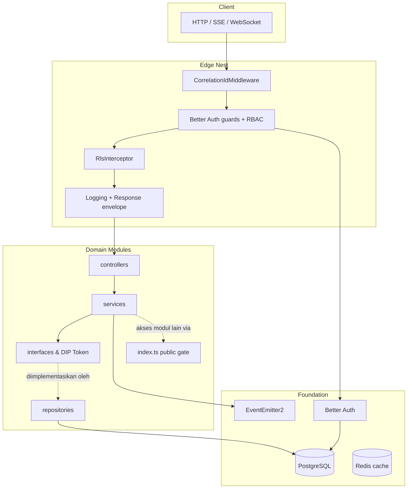
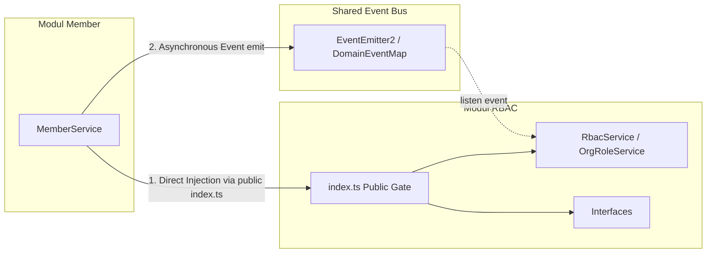
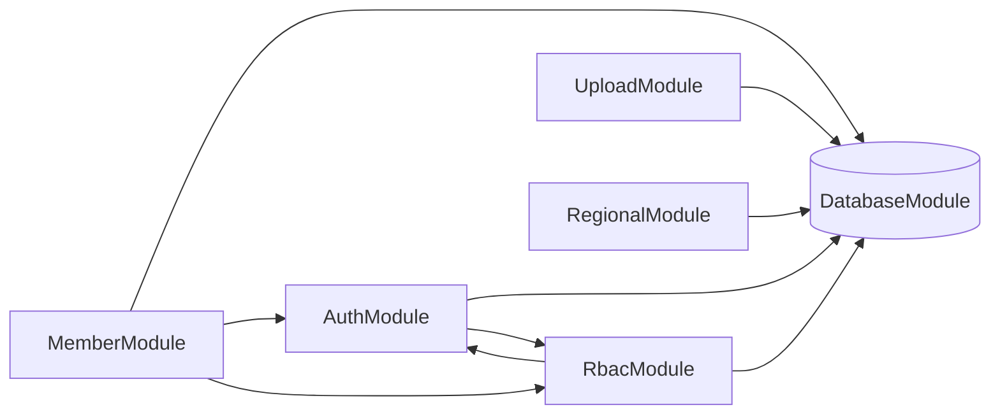

# Arsitektur Backend — NestJS 11 Boilerplate

Dokumen ini menjelaskan **bagaimana codebase disusun**, **alur request**, dan **aturan dependensi** antar bagian. Ini boilerplate reusable multi-organisasi; modul sample opsional ada di [`samples/README.md`](samples/README.md).

Untuk aturan modul dan anti-pattern: [`modular-monolith.md`](modular-monolith.md), [`anti-patterns-reference.md`](anti-patterns-reference.md).

---

## 1. Pola arsitektur

**Modular monolith** idiomatik NestJS dengan penegakan disiplin **5 Prinsip SOLID (SRP, OCP, LSP, ISP, DIP)** — satu proses deployable, tiap modul di `src/modules/<nama>/` memiliki batas yang tegas dengan struktur seragam (`controllers/`, `services/`, `repositories/`, `interfaces/`, `dto/`, `index.ts`), dan komunikasi antar modul dilakukan secara eksplisit lewat **gerbang publik root `index.ts`** atau **event bus asinkron** (`EventEmitter2`). Detail arsitektur & SOLID: [§2](#2-arsitektur-modular-monolith--prinsip-solid).

Batas modul tegas: **dilarang keras** import silang ke subfolder internal (`controllers/`, `services/`, `repositories/`, dll.) modul lain.

| Konsep        | Implementasi                                                                  |
| ------------- | ----------------------------------------------------------------------------- |
| Satu binary   | `main.ts` → `AppModule`                                                       |
| Batas modul   | `src/modules/<nama>/index.ts` sebagai gerbang publik resmi lintas modul       |
| Shared kernel | `src/shared/` — event bus, RLS, realtime, push (bukan domain bisnis)          |
| Cross-cutting | `src/common/`, `src/config/`, `src/logger/`, `src/infrastructure/`            |
| Persistence   | `src/database/schema/` (Drizzle) + repository per modul                       |



---

## 2. Arsitektur Modular Monolith & Prinsip SOLID

### Kenapa Modular Monolith Idiomatik NestJS & SOLID?

Boilerplate ini menyatukan seluruh modul ke dalam **Modular Monolith idiomatik NestJS** dengan penegakan ketat **5 Prinsip SOLID**, menggantikan struktur DDD multi-layer lama (`api/`, `application/`, `domain/`, `facade/`, `infrastructure/`, `presentation/`) yang menimbulkan over-engineering, kedalaman direktori berlebih, dan inkonsistensi antar modul.

Dengan pendekatan Modular Monolith + SOLID:
1. **Maintainability & Lean Structure:** Setiap modul memiliki struktur yang seragam dan intuitif (`controllers/`, `services/`, `repositories/`, `interfaces/`, `dto/`, `index.ts`).
2. **Kopling Rendah (Loose Coupling):** Tidak ada modul yang bergantung pada implementasi internal modul lain; akses publik dibatasi lewat gerbang tunggal `index.ts` atau event bus.
3. **Kemudahan Pengujian (Testability):** Dependency Inversion (DIP) memastikan service bergantung pada abstraksi interface repository, sehingga dapat di-mock 100% pada unit test tanpa menyentuh database Drizzle nyata.

### Penerapan 5 Prinsip SOLID

#### 1. Single Responsibility Principle (SRP)
- **Controller (`controllers/`):** Bertanggung jawab mutlak hanya pada protokol HTTP (ekstraksi params, body, query, session user dari Fastify request) dan mendelegasikan eksekusi langsung ke Service. Controller tidak boleh menjalankan raw query/Drizzle atau logika bisnis.
- **Service (`services/`):** Bertanggung jawab mutlak pada aturan bisnis, verifikasi otorisasi/invarian data, orkestrasi repository, dan event dispatching. Maksimal 300 baris kode per service.
- **Repository (`repositories/`):** Bertanggung jawab mutlak pada persistensi data (query database Drizzle, filtering, pagination via `BaseRepository`, soft delete). Tidak boleh mengandung logika HTTP atau exception formatting.
- **DTO (`dto/`):** Bertanggung jawab mutlak pada validasi bentuk data input request (`create-*.dto.ts`, `update-*.dto.ts`) dan struktur serialisasi output respons API (`*-response.dto.ts`).

#### 2. Open/Closed Principle (OCP)
- **Extensible Providers via Strategy/Token:** Komponen eksternal (seperti Object Storage pada modul `upload`) diisolasi di balik interface `IObjectStorageService`. Penambahan adapter baru (misal S3, MinIO, R2) dilakukan dengan membuat class baru yang mengimplementasikan interface tersebut tanpa mengubah `UploadService`.
- **Event-Driven Extension:** Efek samping dari suatu use case (seperti pencatatan audit trail, pengiriman email notifikasi, dan invalidasi cache RBAC) dipicu melalui event bus `EventEmitter2`. Modul atau listener baru dapat ditambahkan tanpa memodifikasi kode use-case utama.

#### 3. Liskov Substitution Principle (LSP)
- Seluruh class implementasi repository (misal `MemberRepository`, `RegionalRepository`) wajib mematuhi seluruh kontrak method pada interface-nya (`IMemberRepository`, `IRegionalRepository`).
- Implementasi mock repository dapat disubstitusikan secara penuh ke dalam Service pada unit test tanpa mengubah ekspektasi perilaku program atau menimbulkan runtime error yang tak terduga.
- Tipe kembalian bersifat konsisten: `Promise<T | null>` untuk pencarian tunggal dan `Promise<T[]>` untuk pencarian majemuk/paginasi.

#### 4. Interface Segregation Principle (ISP)
- Interface dirancang terfokus dan ramping (idealnya ≤ 5 sampai 7 method per interface).
- Client atau modul pengonsumsi tidak dipaksa bergantung pada method yang tidak mereka gunakan. Kontrak query dan mutasi dapat dipisahkan bila modul berkembang kompleks.

#### 5. Dependency Inversion Principle (DIP)
- Modul tingkat tinggi (`MemberService`) **tidak bergantung pada modul tingkat rendah (`MemberRepository` konkret)**. Keduanya bergantung pada abstraksi (`IMemberRepository` dan `MEMBER_REPOSITORY_TOKEN`).
- Injeksi dependensi dilakukan melalui NestJS Injection Token:

```typescript
// interfaces/member-repository.interface.ts
export const MEMBER_REPOSITORY_TOKEN = Symbol('MEMBER_REPOSITORY_TOKEN');

export interface IMemberRepository {
  findById(id: string): Promise<MemberRecord | null>;
  findByOrgAndUser(orgId: string, userId: string): Promise<MemberRecord | null>;
  listByOrg(orgId: string, query: ListMemberQuery): Promise<PaginatedResult<MemberRecord>>;
  create(data: NewMemberRecord): Promise<MemberRecord>;
  updateRole(id: string, role: string): Promise<MemberRecord>;
  delete(id: string): Promise<void>;
}

// services/member.service.ts
@Injectable()
export class MemberService {
  constructor(
    @Inject(MEMBER_REPOSITORY_TOKEN)
    private readonly memberRepo: IMemberRepository,
    private readonly eventEmitter: EventEmitter2,
  ) {}
}

// member.module.ts
@Module({
  controllers: [MemberController],
  providers: [
    MemberService,
    {
      provide: MEMBER_REPOSITORY_TOKEN,
      useClass: MemberRepository,
    },
  ],
  exports: [MemberService, MEMBER_REPOSITORY_TOKEN],
})
export class MemberModule {}
```

### Komunikasi Antar Modul & Batasan Arsitektur



1. **Gate Publik (`index.ts`):** Satu-satunya pintu masuk resmi modul adalah file `index.ts` di root folder modul (`src/modules/<nama_modul>/index.ts`). Modul mengekspor Module, Service publik, DTO, dan interface token.
2. **ESLint Boundary Guard (`modular-monolith/no-cross-module-import`):** Melarang keras impor lintas modul yang langsung merujuk ke subfolder internal (`controllers/`, `services/`, `repositories/`, `infrastructure/`, `domain/`, `presentation/`, `facade/`, `application/`).
3. **Komunikasi Asinkron:** Aksi lintas modul yang tidak memerlukan return value instan (misal email sambutan, invalidasi cache, audit log) disalurkan melalui `EventEmitter2` dengan typed registry `DomainEventMap`.

---

## 3. Stack utama

| Lapisan           | Teknologi                                                                 | Catatan                                              |
| ----------------- | ------------------------------------------------------------------------- | ---------------------------------------------------- |
| Runtime & HTTP    | NestJS 11 + **Fastify**                                                   | Versioning URI: `/v1/...`                            |
| Validasi input    | `class-validator` + `ValidationPipe`                                      | Global di bootstrap                                  |
| Env               | **Zod** (`config/env.validation.ts`)                                      | Fail fast saat startup                               |
| Database          | PostgreSQL + **Drizzle ORM**                                              | Pool global `DatabaseModule`                         |
| Auth              | **Better Auth** + plugin `organization`                                   | Multi-org, dynamic access control                    |
| Cache sesi / auth | Redis (`GlobalCacheModule`, `BetterAuthCacheModule`)                      | Opsional per env                                     |
| Queue             | BullMQ                                                                    | Konfigurasi ada; default tidak dimuat di `AppModule` |
| Log               | Winston (`LoggerModule`)                                                  | `LoggingInterceptor` per request                     |
| i18n              | `nestjs-i18n`                                                             | Resolver: query, cookie, header, Accept-Language     |
| Observability     | `MetricsModule`                                                           | Metrik aplikasi                                      |
| API docs          | OpenAPI / Scalar (bootstrap) + Better Auth OpenAPI di `/v1/auth/api/docs` | Lihat `bootstrap/openapi.config.ts`                  |

---

## 4. Peta direktori (tingkat atas)

```text
src/
├── main.ts                 # Bootstrap Fastify, global pipes/interceptors
├── app.module.ts           # Komposisi modul core
├── bootstrap/              # CORS, helmet, rate limit, multipart, OpenAPI
├── config/                 # Factory config per domain (app, auth, email, upload, …)
├── database/               # DatabaseModule, schema Drizzle terpusat
├── common/                 # Error, DTO paginasi, cache, base repository, filter global
├── logger/                 # Winston
├── infrastructure/         # Metrik dan wiring infrastruktur non-domain
├── i18n/                   # Terjemahan (mis. auth-errors)
├── modules/                # Modul domain (auth, member, rbac, …)
└── shared/                 # Foundation layer (events, RLS, realtime, push)
```

**Schema DB** diekspor dari `src/database/schema/index.ts` agar Better Auth adapter dan modul memakai definisi tabel yang sama.

**Migrasi:** `drizzle/` (baseline + migrasi lanjutan, mis. RBAC katalog `0001_rbac_permissions.sql`).

---

## 5. Komposisi startup (`AppModule`)

Urutan import di [`src/app.module.ts`](../src/app.module.ts) mengikuti prinsip: **config & infra dulu**, lalu **shared**, lalu **domain core**.

| Kelompok      | Modul                                                                                                | Peran                                             |
| ------------- | ---------------------------------------------------------------------------------------------------- | ------------------------------------------------- |
| Infra global  | `GlobalCacheModule`, `ConfigModule`, `I18nModule`, `LoggerModule`, `DatabaseModule`, `MetricsModule` | Env, log, DB, metrik                              |
| Shared kernel | `SharedEventsModule`, `RealtimeModule`, `PushNotificationModule`                                     | Event bus, SSE, FCM adapter                       |
| Domain core   | `AuthModule`, `RbacModule`, `MemberModule`, `RegionalModule`, `UploadModule`, `HealthModule`         | Auth, izin, anggota, referensi CRUD, file, health |
| Lain          | `SchedulingModule`                                                                                   | Cron terjadwal                                    |

**Provider global aplikasi:**

- `AllExceptionsFilter` — kesalahan terstruktur + i18n
- `LoggingInterceptor` — log request/response
- `ResponseEnvelopeInterceptor` — bentuk respons API konsisten

**Middleware:** `CorrelationIdMiddleware` pada semua rute (jejak log).

**Tidak termuat default di `AppModule`:** `PaymentModule`, `NotificationModule`, WhatsApp, AI — tambahkan manual atau salin pola dari [`src/modules/_template/`](../src/modules/_template/) / [`samples/`](samples/README.md).

---

## 6. Struktur dalam modul domain

Setiap modul bisnis mengikuti struktur standar modular idiomatik (contoh referensi: `src/modules/regional/`, `src/modules/member/`, `src/modules/_template/`):

```text
src/modules/<nama_modul>/
├── controllers/
│   ├── <nama_modul>.controller.ts        # [SRP] HTTP routing, guards, interceptors, Swagger
│   └── <nama_modul>.controller.spec.ts   # Unit test controller
├── services/
│   ├── <nama_modul>.service.ts           # [SRP] Logika bisnis, validasi, orkestrasi
│   └── <nama_modul>.service.spec.ts      # Unit test service (mock repository)
├── repositories/
│   ├── <nama_modul>.repository.ts        # [SRP & DIP] Akses data konkret berbasis Drizzle ORM
│   └── <nama_modul>.repository.spec.ts   # Unit test repository
├── interfaces/
│   ├── <nama_modul>-repository.interface.ts # [ISP & DIP] Kontrak repository + Injection Token
│   ├── <nama_modul>-service.interface.ts    # [ISP] Kontrak public service bila dikonsumsi modul lain
│   └── index.ts                             # Export seluruh interface dan token modul
├── dto/
│   ├── create-<nama_modul>.dto.ts        # [SRP] Validasi payload request via class-validator
│   ├── update-<nama_modul>.dto.ts        # [SRP] Validasi payload update
│   └── <nama_modul>-response.dto.ts      # [SRP] Serialisasi & struktur respons API
├── <nama_modul>.module.ts                # [OCP] Konfigurasi dependency injection NestJS
└── index.ts                              # Boundary Gate: Titik akses publik untuk modul lain
```

**Alur dependensi (searah & decoupled):**

```text
Controller → Service → [Interface / Token]
                             │
                     (diimplementasikan)
                             ↓
                         Repository → Database
```

### Aturan lintas modul

1. Modul **A** hanya boleh mengimpor dari root modul **B** (`modules/B` atau `modules/B/index.ts`) atau kontrak publik (`modules/B/interfaces`).
2. Modul **B** mendaftarkan provider dengan injection token (`provide: TOKEN, useClass: Repository`) dan mengekspor service atau token yang diizinkan untuk digunakan di modul lain via `<nama>.module.ts` dan diekspos di `index.ts`.
3. **Dilarang keras:** `import ... from '../member/controllers/...'`, `../member/services/...'`, atau `../member/repositories/...'` dari modul lain (dicek otomatis oleh ESLint `modular-monolith/no-cross-module-import`).
4. **Komunikasi longgar:** `EventEmitter2` + `DomainEventMap` di [`src/shared/events/domain-event-registry.ts`](../src/shared/events/domain-event-registry.ts).

---

## 7. Request HTTP — urutan penanganan

1. **Fastify** menerima request (body limit, proxy trust dari config).
2. **Correlation ID** ditetapkan di middleware.
3. **Better Auth** (`@thallesp/nestjs-better-auth`): sesi, organisasi aktif, guard global (kecuali route `@AllowAnonymous`).
4. **`RlsInterceptor`**: mengisi `RlsContext` (AsyncLocalStorage) dengan `organizationId` dari sesi — dipakai repository/admin yang aware tenant.
5. **RBAC**: `@RequirePermission('resource:action')` + `MemberHasPermission` (Better Auth) + metadata scope (`PermissionScopeInterceptor`).
6. **Controller** memanggil **service**, service memanggil **repository** (via Symbol token) / service modul lain (via `index.ts`) / `AuthService.api`.
7. **Response envelope** dan logging diterapkan pada keluar.

Auth routes Better Auth dipasang di path terpisah (`auth.path`, default di bawah `/v1/auth`), tidak selalu melalui controller Nest domain.

---

## 8. Autentikasi & multi-organisasi

| Komponen     | Lokasi                                               | Fungsi                                                           |
| ------------ | ---------------------------------------------------- | ---------------------------------------------------------------- |
| Factory auth | `src/modules/auth/auth.ts`                           | `betterAuth()`, plugin organization, hooks                       |
| Nest wiring  | `src/modules/auth/auth.module.ts`                    | Async factory: load permission statement dari DB                 |
| User/session | Schema Better Auth (`user`, `session`, `account`, …) | Drizzle adapter                                                  |
| Organisasi   | `organization`, `member`, `invitation`               | Creator = `owner`, limit dari config                             |
| Role per org | `organization_role`                                  | JSON `permission` + `permission_scopes` (dynamic access control) |

**Hook penting (`organizationHooks`):**

- `afterCreateOrganization` — seed role dari tabel **`rbac_role_template`** (fallback konstanta bootstrap jika kosong).
- `afterAddMember` / `afterAcceptInvitation` — invalidasi cache RBAC + bridge ke `MemberModule`.

Statement Better Auth (resource → actions) dimuat saat startup dari tabel **`rbac_permission`**. Permission **baru** di katalog memerlukan **restart** agar statement AC terbarui.

Detail operasional: [`auth.md`](auth.md).

---

## 9. RBAC (access control)

| Lapisan           | Tabel / API          | Deskripsi                                                                              |
| ----------------- | -------------------- | -------------------------------------------------------------------------------------- |
| Katalog global    | `rbac_permission`    | CRUD permission (`/rbac/permissions`) — bukan lagi hardcoded constant                  |
| Template org baru | `rbac_role_template` | Default `owner` / `admin` / `member`                                                   |
| Role per org      | `organization_role`  | CRUD role + assignment permission (`/rbac/roles`, Better Auth `createOrgRole` / dll.)  |
| Assign ke user    | `member.role`        | `PATCH /admin/members/:id/role`, undangan — nama role harus ada di `organization_role` |

Modul `RbacModule` juga menyediakan **permission scope** (`permissionScopes` JSON), **audit trail**, dan cache invalidation via event `rbac.cache.invalidate`.

Konstanta `permissions.constant.ts` hanya **bootstrap** untuk test / DB kosong.

---

## 10. Lapisan data

- **Drizzle**: `DRIZZLE` token di-inject ke repository; pola umum `BaseRepository` (`soft delete`, paginasi) di `src/common/repository/base.repository.ts`.
- **Pool**: satu `pg.Pool` shared (`getSharedPool()`) — dipakai Better Auth factory dan Drizzle.
- **Schema**: file per concern di `src/database/schema/`; modul boleh punya schema tambahan di `repositories/` jika hanya dipakai modul itu (contoh `pending-member-link.schema.ts`).
- **RLS aplikasi**: bukan selalu RLS Postgres native — konteks tenant lewat `RlsContext` untuk query yang memfilter `organizationId`.

---

## 11. Foundation layer (`src/shared/`)

Ringkasan; tutorial lengkap: [`src/shared/README.md`](../src/shared/README.md).

| Subfolder            | Fungsi                                                                  |
| -------------------- | ----------------------------------------------------------------------- |
| `events/`            | `EventEmitterModule` wildcard, `DomainEventMap` untuk type-safe payload |
| `database/`          | `RlsContext`, `RlsInterceptor`                                          |
| `realtime/`          | SSE admin / monitor                                                     |
| `push-notification/` | Adapter FCM (no-op jika tidak dikonfigurasi)                            |
| `scheduling/`        | Modul cron                                                              |

Ini **bukan** tempat logic domain (order, invoice, dll.) — hanya kemampuan horizontal.

---

## 12. Error, respons API, dan DTO

- **Domain / bisnis:** `BusinessError` (`notFound`, `forbidden`, `conflict`, …) → `AllExceptionsFilter` → DTO error + kode.
- **Envelope sukses:** `ResponseEnvelopeInterceptor` (konsisten di API Nest).
- **Paginasi:** `PaginatedResponseDto`, helper di `common/dto/`.
- **Swagger:** DTO di `dto/` dengan decorator `@ApiProperty`.

---

## 13. Upload & object storage

- Modul `upload`: upload via multipart (bootstrap), metadata di DB, file di **S3-compatible** (MinIO di `docker-compose`) lewat `S3ObjectStorageAdapter` yang mengimplementasikan `IObjectStorageService` (via token `OBJECT_STORAGE_TOKEN`).
- Stream/read tetap bisa lewat route uploads (lihat modul upload).

---

## 14. Email

- `EmailModule`: pengiriman + template HTML di `modules/email/templates/`.
- Dipanggil dari hook Better Auth (reset password, verifikasi, undangan organisasi) dan modul lain yang membutuhkan notifikasi email.

---

## 15. Menambah modul baru

1. Salin struktur [`src/modules/_template/`](../src/modules/_template/).
2. Definisikan interface repository & Symbol token di `interfaces/`.
3. Implementasikan repository di `repositories/` dan service logika bisnis di `services/`.
4. Definisikan DTO di `dto/` dan controller di `controllers/`.
5. Daftarkan provider di `<nama_modul>.module.ts` dan ekspor public API di `index.ts`.
6. Import `YourModule` di `src/app.module.ts` (atau biarkan opsional).
7. Tambah schema/migrasi Drizzle bila perlu.
8. Extend `DomainEventMap` jika mem-publish event baru.
9. Jalankan `bun test`, `bun run lint`, `bun run build`.

Panduan singkat: [`scaffold-new-module.md`](scaffold-new-module.md).

---

## 16. Tier modul (core vs opsional)

| Tier                  | Contoh                                              | Registrasi                                                                        |
| --------------------- | --------------------------------------------------- | --------------------------------------------------------------------------------- |
| **Core**              | auth, member, rbac, regional, upload, email, health | Sudah di `AppModule`                                                              |
| **Referensi**         | `_template`, regional (Modular SOLID idiomatik)     | Template / pola                                                                   |
| **Opsional / sample** | payment, notification, whatsapp, ai                 | Manual import; lihat [`boilerplate-module-tiers.md`](boilerplate-module-tiers.md) |

---

## 17. Konfigurasi & integrasi opsional

Env divalidasi Zod; integrasi yang tidak dikonfigurasi cenderung **no-op** (FCM, queue, dll.) agar core tetap jalan di lokal.

Detail env dan flag fitur: [`configuration-optional-integrations.md`](configuration-optional-integrations.md).

---

## 18. Diagram dependensi modul core (sederhana)



`AuthModule` ↔ `RbacModule`: auth memuat statement permission dari DB; RBAC memakai `AuthService` untuk role org Better Auth.

---

## 19. Referensi cepat

| Topik                             | Dokumen                                                          |
| --------------------------------- | ---------------------------------------------------------------- |
| Arsitektur Modular Monolith & SOLID | [§2 di dokumen ini](#2-arsitektur-modular-monolith--prinsip-solid) |
| Batas modul & ESLint              | [`modular-monolith.md`](modular-monolith.md)                     |
| Auth & organisasi                 | [`auth.md`](auth.md)                                             |
| Error handling                    | [`error-handling.md`](error-handling.md)                         |
| DB & migrasi baseline             | [`drizzle-migration-baseline.md`](drizzle-migration-baseline.md) |
| Shared kernel API                 | [`src/shared/README.md`](../src/shared/README.md)                |
| Kekuatan boilerplate              | [`boilerplate-strengths.md`](boilerplate-strengths.md)           |
